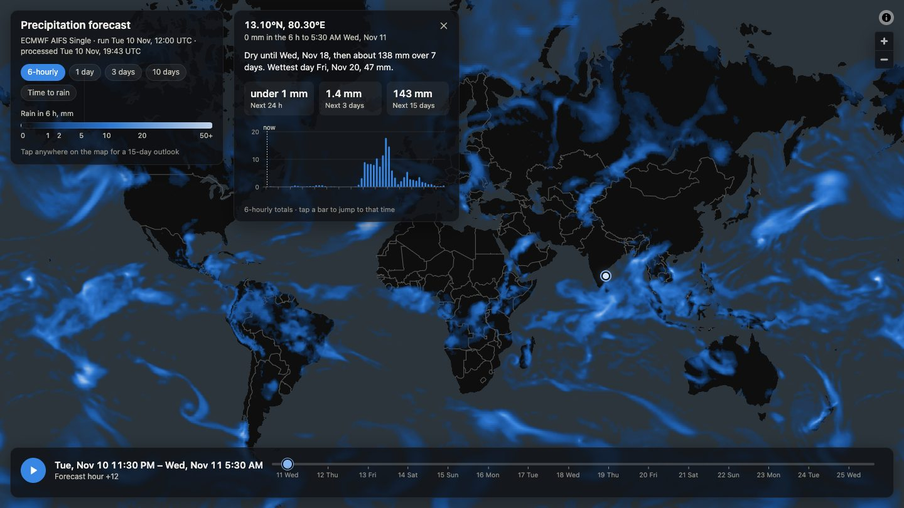
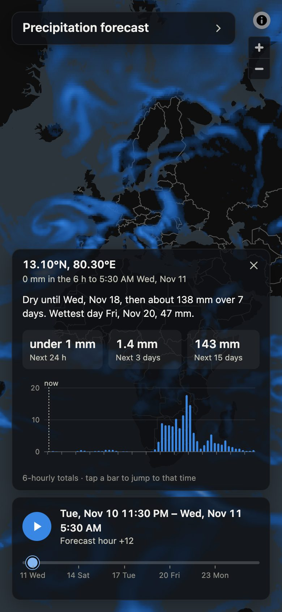

# Precipitation Forecast

**Live: https://yagyasoni.github.io/weather-app/**

A 15-day global rain forecast you can read in one tap. It fetches the latest
ECMWF AIFS run, turns it into small image files, and serves an interactive
map with no backend. Built for the QUEST Lab Full Stack AI pre-doctoral
application (Project 1).



What it does:

- **Tap anywhere for a plain-language outlook.** "Dry until Wed 18 Nov, then
  about 138 mm over 7 days", with totals and a 15-day chart of 6-hourly rain.
- **Play the forecast.** An animated map of 6-hourly rain, with totals for
  1, 3 and 10 days and a "time until rain, from now" layer.
- **Share any view.** Layer, time and location live in the URL.
- **Stays current by itself.** A scheduled job publishes each new run within
  about an hour, and an open page moves onto it.
- **Works on a phone.** The layout reflows from wide desktop to a bottom
  sheet on small screens.



The reasoning behind the main choices is in [docs/DESIGN.md](docs/DESIGN.md).

Forecast data: [ECMWF Open Data](https://www.ecmwf.int/en/forecasts/datasets/open-data)
(AIFS Single, 0.25°, 6-hourly to 360 h), licensed
[CC BY 4.0](https://creativecommons.org/licenses/by/4.0/). Code: MIT.

## Architecture

There is no server. A scheduled Python job turns each forecast run into a
folder of small PNG "data textures" plus a JSON manifest, and a static web
page renders them.

```
ECMWF Open Data ──▶ pipeline/build.py ──▶ web/public/data/<run_id>/*.png + manifest.json
   (GRIB2, tp)        (every 6 h in CI)              │
                                                     ▼
                                          static site (MapLibre GL JS)
```

Each PNG is an 8-bit grayscale image in Web Mercator (1440 × 1440) holding
rainfall in millimetres with a square-root stretch:

```
g  = round(255 * sqrt(min(mm, vmax) / vmax))
mm = (g / 255)^2 * vmax
```

The same image is both the picture the map colours and the data the UI
reads values back from on click.

## Pipeline

```bash
python3.12 -m venv .venv
.venv/bin/pip install -r pipeline/requirements.txt

# build the latest available run into web/public/data
.venv/bin/python pipeline/build.py

# options
.venv/bin/python pipeline/build.py --out web/public/data/sample --force   # refresh the checked-in sample
.venv/bin/python pipeline/build.py --date 20261109 --time 6                # pin a specific run
.venv/bin/python pipeline/build.py --max-steps 3                           # quick smoke test
.venv/bin/python pipeline/build.py --source aws                            # use a cloud mirror
```

What the script does for one run:

1. Asks the `ecmwf-opendata` client for the latest run where every requested
   step of total precipitation (`tp`) is published, then downloads only
   those fields via the GRIB index byte ranges (about 20 MB).
2. Opens the GRIB with `cfgrib`, sorts latitude north to south and shifts
   longitude into -180..180.
3. Converts to millimetres using the units declared in the GRIB (IFS stores
   `tp` in metres, AIFS in kg m⁻², which is numerically mm), then differences
   consecutive steps. `tp` is accumulated since forecast start, so
   per-interval rain is `tp[i] - tp[i-1]`, clipped at zero to remove
   numerical noise.
4. Warps every field to Web Mercator with a nearest-neighbour lookup table,
   so it can be draped on a web map without distortion.
5. Writes one PNG per 6-hour interval and accumulation PNGs at 24, 72 and
   240 h.
6. Writes `manifest.json` (steps, valid times, encoding constants, bounds,
   attribution) and updates `latest.json`. Keeps the two newest runs.

Output layout:

```
web/public/data/
  latest.json
  2026110906/
    manifest.json
    tp_006.png … tp_360.png
    acc_024.png  acc_072.png  acc_240.png
```

`web/public/data/sample/` is one real run checked into the repo so the
front end can be developed offline. Everything else under `web/public/data/`
is generated and ignored by git.

## Web app

Static Vite + TypeScript site using MapLibre GL JS. No framework, no server.

```bash
cd web
npm install
npm run dev        # http://127.0.0.1:5173/weather-app/  (reads data/sample)
npm run build      # type-checks, then bundles into web/dist
npm run preview    # serves the production build at /weather-app/
```

How it works:

- `src/data.ts` loads `latest.json` and the manifest, then downloads frame
  PNGs a few at a time, nearest to the current frame first. Frames are decoded
  on demand into one byte per pixel and kept in a small LRU; the compressed
  blobs for all 60 frames are about 16 MB.
- `src/colormap.ts` turns grey levels into colours with a single-hue blue ramp
  on a square-root scale, transparent below 0.2 mm. The same ramp draws the
  legend, so the legend is correct by construction.
- `src/overlay.ts` paints a frame through the colour lookup table onto a
  canvas and drapes it over the map as a MapLibre canvas source in Web
  Mercator, inserted beneath the basemap's label layers.
- `src/timeline.ts` is the slider, play/pause, keyboard shortcuts (space,
  arrows, home, end), the time readout in the viewer's time zone and the
  day ticks. Static layers freeze it and replace the readout.
- `src/layers.ts` defines the selectable layers from the manifest: 6-hourly
  rain (animated), rain totals for the next 24 h, 3 days and 10 days, and
  time until rain from now (an orange ramp, light for soon and dark for far
  off), which `src/firstrain.ts` derives from the 6-hourly frames.
  Each layer carries its own lookup table, legend gradient and ticks.
- `src/point.ts` and `src/narrative.ts` power the location card. A tap on
  the map reads the same pixel from all 60 frames, draws a 15-day bar chart
  of 6-hourly totals with hover tooltips, shows totals for the next 24 h,
  3 days and 15 days, and writes a rule-based sentence such as "Dry until
  Thursday afternoon, then about 8 mm over 12 hours". Tapping a bar jumps
  the timeline to that period.
- `src/state.ts` keeps layer, time and location in the URL hash, so any
  view can be shared as a link.

Layout is responsive and reflows live on resize, no reload needed. The
header and the location card share one flex container (`.dock`) that spans
from the top of the window to just above the timeline, so they are placed by
flow and cannot overlap; the card shrinks and scrolls before the header does.

- Wide and tall: header and card stack in a left column.
- Wide but under 820 px tall: they sit side by side, stopping short of the
  map buttons in the top-right corner.
- Up to 720 px wide: the header sits at the top beside the map buttons and
  collapses to its title when a location is open, the card becomes a bottom
  sheet above the timeline, and the timeline wraps to two rows.
- Short screens drop secondary text; coarse pointers get larger targets.
- The day labels under the slider measure themselves and hide whichever
  would collide at the current width.

The dev server reads the checked-in sample run. The production build reads
`data/latest.json`, which the pipeline writes in CI, and falls back to the
sample with a visible badge if that file is missing. The site is built for
the `/weather-app/` path used by GitHub Pages; set `BASE_PATH=/` to build for
a host that serves it at the root.

Basemap: Carto Dark Matter vector tiles (no API key). Data attribution to
ECMWF is shown in the map's attribution control as the licence requires.

## Deployment

`.github/workflows/update.yml` runs on every push to `main` that touches the
pipeline, the web app or the workflow, on manual dispatch, and hourly at 17
minutes past.

1. It asks ECMWF for the latest fully published run and reads the run id
   the live site is showing. A scheduled run stops here when the two match,
   so most hourly runs take a few seconds.
2. Otherwise it runs the offline tests, builds the forecast data (falling
   back to the AWS mirror if the ECMWF portal fails), builds the site and
   deploys it to GitHub Pages as an artifact. Forecast PNGs never enter git
   history.

Things to know:

- GitHub disables scheduled workflows after 60 days without repository
  activity. Any push, or re-enabling the workflow in the Actions tab,
  restarts it. Until then the site keeps showing the last run with a
  "this forecast run is N h old" badge.
- Each deploy replaces the previous run's files. A page left open checks
  for a newer run every ten minutes and when it regains focus, and offers to
  load it. If a file from the old run fails to load and a newer run exists,
  the page reloads onto it, keeping the layer and location.
- Scheduled runs can start late when GitHub is busy. A new AIFS run usually
  appears on the site within about an hour of ECMWF publishing it.

## Known limits

- Rain values are stored in 8 bits with a ceiling. A 6-hour total above
  200 mm, or an accumulation above 500 mm, is clipped to the ceiling on the
  map and in the location chart. The manifest's `max_mm` keeps the true
  maximum per frame. Both ceilings are constants at the top of
  `pipeline/build.py`; raising them costs precision for light rain.
- Precision follows a square-root curve: about 0.03 mm near zero, 0.1 mm at
  1 mm, 1 mm at 80 mm.
- The model grid is 0.25° (about 28 km), resampled by nearest neighbour.
  Values are grid-cell averages, not point measurements.
- "Time until rain" is computed in the browser from the 6-hourly frames,
  measured from the moment you look, so it needs all 60 frames decoded once
  (a second or two) the first time the layer is opened.
- The checked-in sample run under `web/public/data/sample` is a fixed
  snapshot used for development and as a fallback; it goes stale by design.
- The forecast is a single deterministic AIFS run. There is no ensemble, so
  the app shows no uncertainty.

## Tests

```bash
# pipeline
.venv/bin/pip install -r pipeline/requirements-dev.txt
.venv/bin/pytest              # offline, about a second
.venv/bin/pytest --live -s    # also hits ECMWF and Open-Meteo, about a minute

# web app
cd web
npm test                      # unit tests (Vitest), under a second
npx playwright install chromium-headless-shell   # once
npm run e2e                   # browser tests (Playwright), about 15 seconds
```

Pipeline (`pipeline/tests/`):

- `test_functions.py` — unit tests for the pure functions: Mercator row
  latitudes, warp lookup tables (including the dateline and a 0..360
  longitude grid), the square-root encoding round trip, unit handling, and
  run pruning, including that the run just built is never pruned.
- `test_sample.py` — contract checks on the checked-in sample run: manifest
  fields, 60 frames in order with correct valid times, every PNG 8-bit
  grayscale at the declared size, decoded maxima matching the manifest,
  plausible global mean (catches unit mistakes), and accumulations growing
  with lead time.
- `test_live.py` — marked `live`, skipped by default. Builds a fresh 4-step
  run, checks 1600 random pixels against the source GRIB within the
  encoding's quantisation error, and compares 6-hourly totals at the wettest
  mid-latitude point against Open-Meteo's feed of the same AIFS run.

Web app:

- `web/src/*.test.ts` — unit tests for longitude wrapping and pixel lookup,
  the time-until-rain calculation, and the timeline's behaviour with fake
  timers: a failed frame does not stop later frames, pausing and resuming
  during a slow frame leaves one playback loop, and Space is left to a
  focused button.
- `web/e2e/app.spec.ts` — browser tests against the dev server with a fixed
  clock and no external basemap. They break and delay individual requests to
  check that a failed frame is retried, a failed location query offers a
  working retry, a newer run is offered and is loaded automatically when the
  old files are gone, and quick layer switching never shows a late image.
